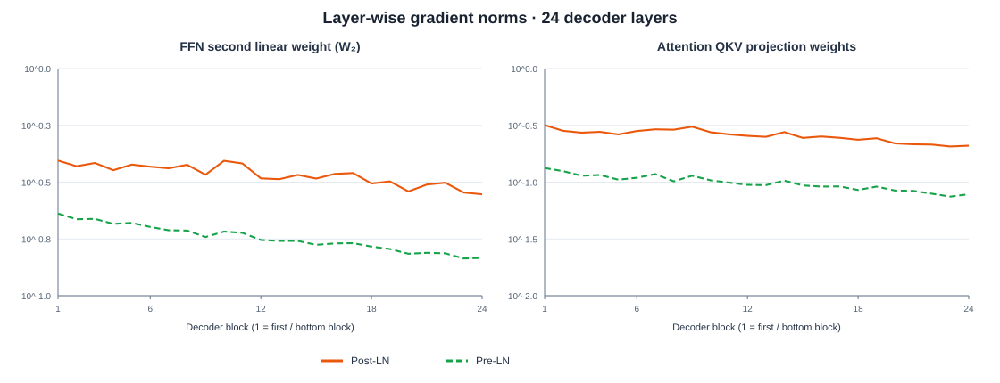
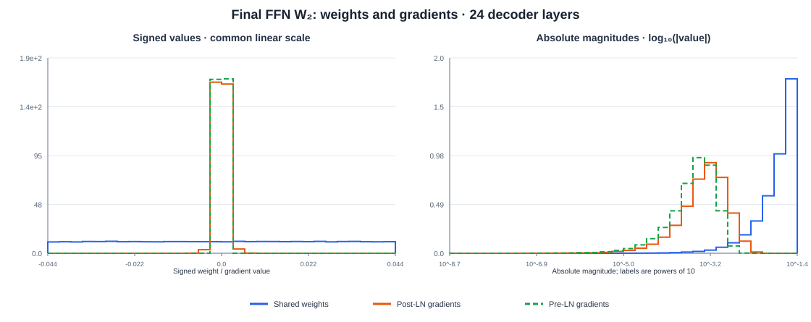
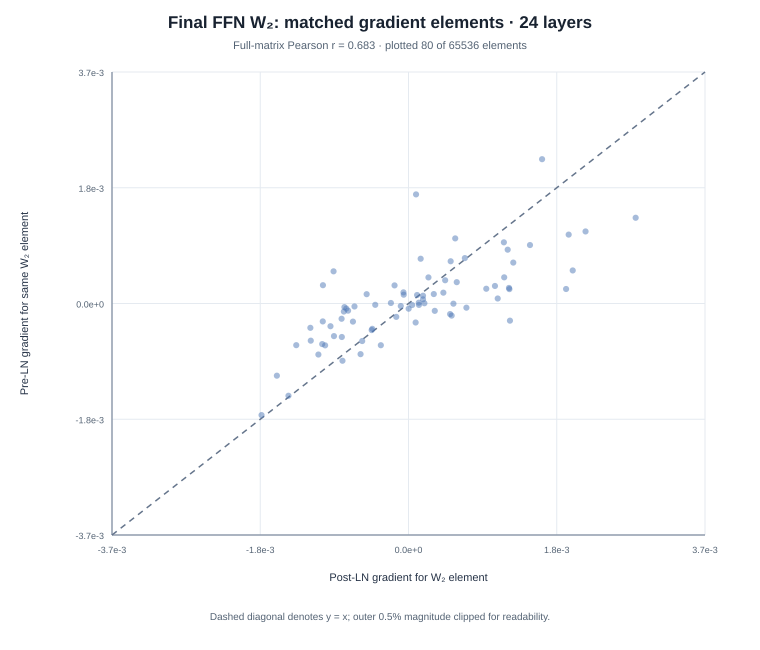
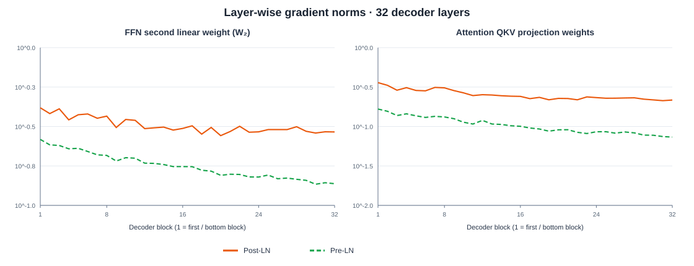
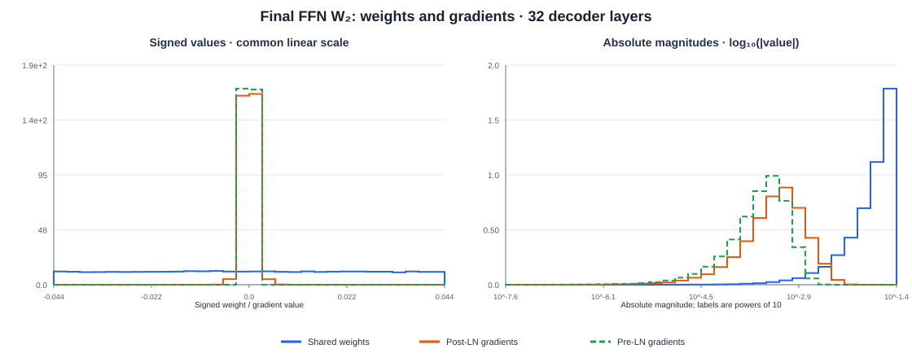
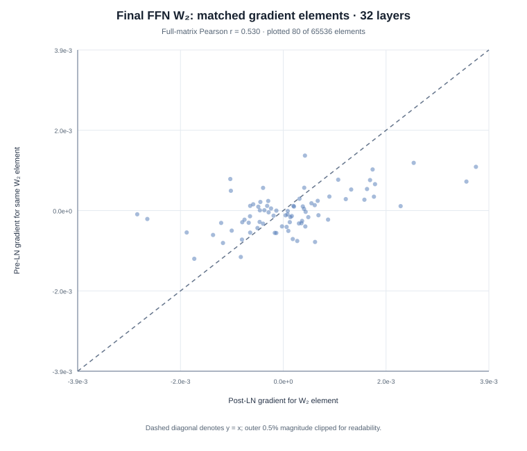
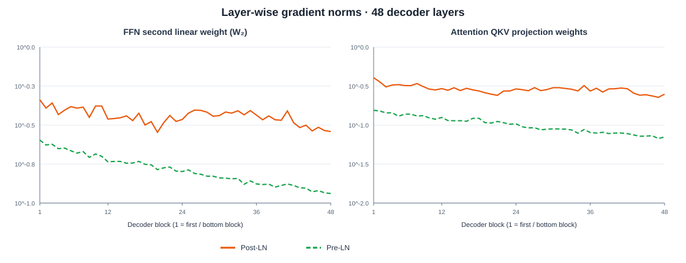
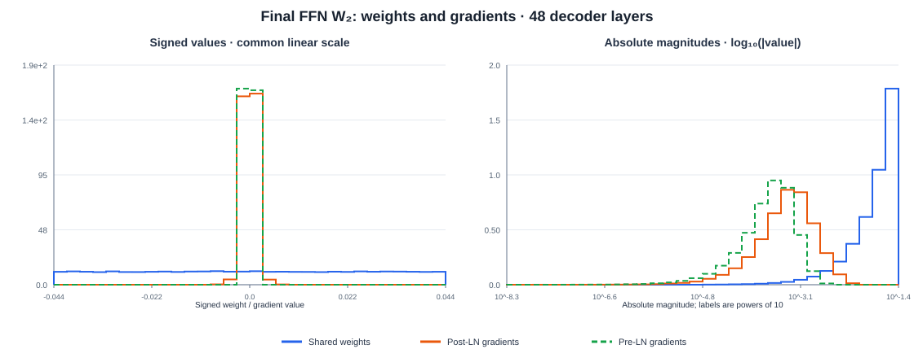
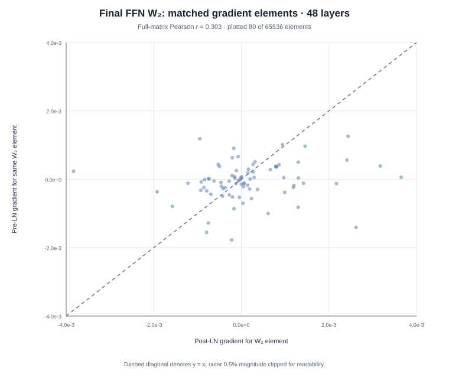

# Pre-LN vs Post-LN: Gradient-flow experiments

A small PyTorch causal Transformer experiment comparing **Pre-LayerNorm (Pre-LN)** and **Post-LayerNorm (Post-LN)** at initialization.

For each model depth, the experiment uses the same batch, targets, loss, and identical values for every parameter shared between the two models. It runs one forward pass and one backward pass, without an optimizer step.

## Repository layout

- `experiments/pre_post_ln_demo.py` — runnable experiment and plotting code.
- `plots/depth24/`, `plots/depth32/`, `plots/depth48/` — the three recorded plots for each depth, in SVG format.
- `results/depth24/`, `results/depth32/`, `results/depth48/` — compact JSON used by the companion study page, including histogram bins, per-layer gradient norms, and matched scatter samples.

## Install

Python 3.10+ is recommended.

```bash
pip install -r requirements.txt
```

## Re-run the experiments

Run from the repository root:

```bash
python experiments/pre_post_ln_demo.py --n-layers 24 --output-dir results/regenerated/depth24
python experiments/pre_post_ln_demo.py --n-layers 32 --output-dir results/regenerated/depth32
python experiments/pre_post_ln_demo.py --n-layers 48 --output-dir results/regenerated/depth48
```

Each run writes three plot types in both PNG and SVG format, plus a compact JSON data file:
- `layerwise_gradient_norms` — gradient L2 norms for FFN W₂ and attention QKV projection weights at every decoder block.
- `weight_gradient_histogram` — signed values and absolute-magnitude distributions for final FFN W₂ weights and gradients.
- `gradient_scatter` — matched Pre-LN and Post-LN gradients for elements of final FFN W₂.

To also write data directly to another path, use `--web-data-path PATH`.

## Recorded plots

### 24 decoder layers







### 32 decoder layers







### 48 decoder layers







## How to interpret the results

The recorded runs showed larger gradient norms for selected near-output parameters in Post-LN than in Pre-LN. This is an illustrative observation from one initialization and one batch per depth, **not** a statistically established depth-scaling law. Repeat with multiple random seeds and batches before drawing general conclusions.

PyTorch's `nn.MultiheadAttention(h, h, h)` is the correct self-attention API: the same hidden-state tensor is supplied for query, key, and value inputs, then the module applies distinct learned Q/K/V projections internally.

## Reference

Xiong et al. (2020), [On Layer Normalization in the Transformer Architecture](https://proceedings.mlr.press/v119/xiong20b.html), ICML / Proceedings of Machine Learning Research.
